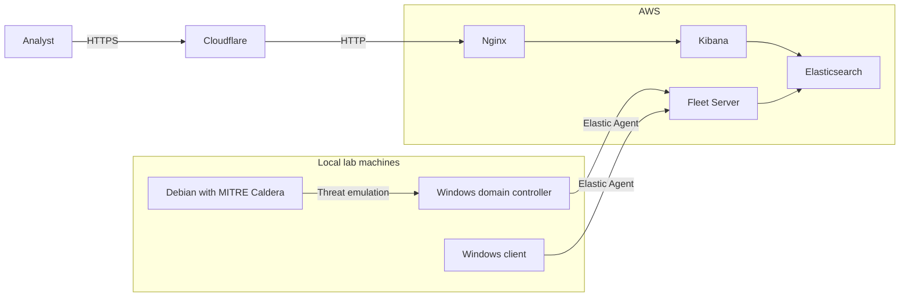

# ELK SIEM on AWS with Terraform

Sienna Central is a small Elastic SIEM lab.

It was built to practise:

- Terraform and AWS infrastructure.
- Windows log collection with Elastic Agents.
- Detection engineering.
- MITRE Caldera threat emulation.
- Detection as code.

**Status:** The lab was used for testing and can be rebuilt with Terraform.

**Scope:** This is a learning lab, not a production-ready SIEM.

## Architecture



## Components

| Component | Purpose |
|---|---|
| AWS EC2 | Runs the Elastic Stack |
| Elasticsearch | Stores events and alerts |
| Kibana | Shows logs, rules, and alerts |
| Fleet Server | Manages the Elastic Agents |
| Windows machines | Generate security events |
| MITRE Caldera | Emulates attacker behaviour |
| Terraform | Builds the AWS infrastructure |
| GitHub Actions | Sends rules to Kibana |

The Elastic Stack runs in Docker on an ARM EC2 instance. Kibana is version
9.5.4.

## The Caldera exercise

The lab was tested before the detection-as-code repository was created.
Caldera acted like a small attacker and ran seven abilities against a Windows
machine:

1. Domain account discovery.
2. Winlogon registry modification.
3. UAC bypass.
4. PowerKatz.
5. Clipboard copying.
6. PSTools download and installation.
7. Mimikatz.

Five of the seven abilities succeeded.

The SIEM created 132 open alerts. These alerts helped us create detections for:

- Encoded PowerShell commands.
- User enumeration.
- Registry changes.
- Credential dumping.
- PSTools downloads.
- Brute-force logons.

## Detection as code

The rules are stored in the separate
[`rawleyc/sienna-rules`](https://github.com/rawleyc/sienna-rules) repository.

Rules can be stored as YAML files or NDJSON exports from Kibana.

When a rule change is pushed to `main`, GitHub Actions:

1. Finds the YAML and NDJSON files.
2. Reads the rule objects.
3. Waits for Kibana to become ready.
4. Sends the rules to the Detection Engine API.

The API key used by the workflow needs the Kibana application privilege:

```text
feature_securitySolutionRulesV4.all
```

This is the privilege that allows the workflow to manage Security Solution
rules and exceptions.

## Detection example: brute-force logons

| Field | Value |
|---|---|
| Rule type | Threshold |
| Event | Windows Security event 4625 |
| Logic | 10 or more failed logons per host within 5 minutes |
| ATT&CK technique | T1110: Brute Force |
| Schedule | Every 5 minutes, with a 1-minute look-back |
| Test | 20 failed logon attempts |

The rule waited about four minutes before creating an alert. This was expected:
events needed time to arrive, and the rule ran on a schedule.

The rule groups by `host.name`, so it measures failed logons per machine. A
production rule should also consider the account, source IP, and logon type.

## Deployment

The infrastructure is in [`IaC (SIEM)/`](./IaC%20(SIEM)/).

```powershell
terraform init
terraform plan
terraform apply
```

Terraform creates the EC2 host, security group, DNS records, and GitHub Actions
secrets needed by the rules repository.

## Difficulties we faced

### Kibana was only listening locally

Kibana was running, but Docker published port `5601` only on
`127.0.0.1`. GitHub could not reach it.

We changed the binding to `0.0.0.0:5601` and added a workflow health check.

### The Kibana API had changed

The old bulk endpoint returned `404 Not Found` on Kibana 9.5.4. The sync script
now uses the supported Detection Engine endpoint and sends rules one at a time.

### The API key could log in but could not create rules

Elasticsearch index permissions were not enough. Kibana also needed the
Security Solution application privilege:

```text
feature_securitySolutionRulesV4.all
```

### Terraform planned to replace the EC2 host

The security group was attached with an old Terraform argument. Terraform
thought the whole server needed replacement. We changed it to
`vpc_security_group_ids`, so the existing host could stay in place.

### The public IP changed

When the EC2 host was rebuilt, its public IP changed. GitHub Actions then tried
to use the old address. Terraform updates the GitHub secret, but the workflow
must be run again after the update.

## Security decisions and known gaps

| Area | Lab setup | Safer production approach |
|---|---|---|
| Kibana | Cloudflare and Nginx in front of Kibana | Private access or a protected VPN |
| Elasticsearch | Publicly reachable during testing | Private networking |
| Credentials | Generated for the lab | Use a secrets manager |
| API key | Stored as a GitHub Actions secret | Use short-lived or tightly scoped credentials |
| SSH | Key used for troubleshooting | Use managed access and rotate keys |
| Terraform state | Local state during development | Use an encrypted remote backend |

Do not commit `terraform.tfstate`, private keys, API keys, or passwords.

## Cost and teardown

The EC2 instance cost about $0.15 per hour while running. The lab cost about
$2.21 during testing.

To remove the infrastructure:

```powershell
.\terraform-destroy.ps1
```

For automatic approval:

```powershell
.\terraform-destroy.ps1 -AutoApprove
```

After teardown, check AWS, Cloudflare, GitHub Actions secrets, and the local
virtual machines for anything that should also be removed.
